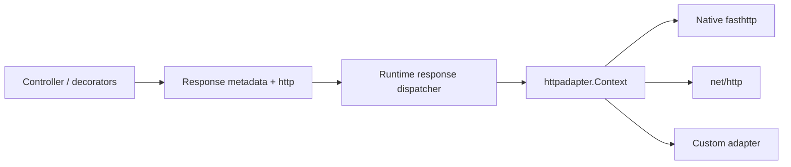

# Engine-independent HTTP responses

NestGo controllers can return ordinary values, return a typed `http.Response[T]`, or
write explicitly through `@Res()`. These operations use a transport-neutral contract; your
controller does **not** import the fasthttp or net/http engine.

## Return values and helpers

```go
import "github.com/kevenmiano/nestgo/http"

@Controller("/users")
type UsersController struct{}

@Get("/{id}")
func (c *UsersController) FindOne(@Param("id") id string) http.Response[UserDTO] {
    user := UserDTO{ID:id}
    return http.OK(user).
        WithHeader("Cache-Control", "no-store")
}

@Post("/")
func (c *UsersController) Create(@Body() dto UserDTO) http.Response[UserDTO] {
    return http.Created(dto)
}

@Delete("/{id}")
func (c *UsersController) Remove(@Param("id") id string) http.Response[any] {
    return http.NoContent()
}
```

**Helpers:** `JSON(value)`, `Text(string)`, `OK(value)`, `Created(value)`,
`Accepted(value)`, `NoContent()`, `Redirect(url, optionalStatus)`,
`WithStatus(code)`, `WithHeader(name, value)` and `WithCookie(Cookie)`.
Go does not support optional type arguments. Return `http.Response[UserDTO]` when explicit response metadata is needed,
`http.Result` when the body type is not statically known, or return `UserDTO` directly
for implicit JSON serialization. `http.OK(user)` infers the type argument `UserDTO`.
Responses are immutable-by-convention: fluent methods return a modified **copy**.
A typed response takes precedence over a route's default status.

Ordinary values remain JSON-serialized, including plain strings. Use
`http.Text("hello")` to send a `text/plain` body.
GET defaults to 200; POST defaults to 201. Status 204, 304 and informational
responses are sent without a body.

## Declarative response decorators

```go
@Get("/cache")
@HttpCode(202)
@Header("Cache-Control", "private, max-age=60")
func (c *UsersController) Cached() any { return map[string]bool{"ok": true} }

@Get("/old")
@Redirect("/new", 301)
func (c *UsersController) Moved() string { return "" }
```

`@Header(name, value)` accepts two **quoted string literals**, may repeat, and is
applied before the handler executes; a dynamic writer can override a header.
`@Redirect(url, code)` accepts a quoted URL and optional 3xx integer status
(default 302). A returned `http.Redirect(...)` can override a
static decorator redirect. Invalid decorator arguments fail compilation.

## Explicit response writing

```go
@Get("/download")
func (c *UsersController) Download(@Res() res *http.Writer) error {
    return res.Status(200).
        Header("Content-Disposition", "attachment; filename=hello.txt").
        Send("hello")
}

@Get("/preview")
func (c *UsersController) Preview(@Res({passthrough:true}) res *http.Writer) any {
    res.Status(202).Header("X-Preview", "yes")
    return map[string]bool{"ready": true}
}
```

`@Response()` aliases `@Res()`. An explicit `@Res()` handler owns the
response; NestGo **does not** automatically serialize its return value.
If the handler completes without writing, the runtime responds with a 500
instead of leaving the request hanging. Use `@Res({passthrough:true})` to
set headers/status/cookies and still use automatic serialization.
`http.Writer` supports `Status`, `Header`, `Cookie`, `JSON`,
`Send`, `End`, and `Redirect`; writing twice returns an error.

Cookies use `http.Cookie` with standard fields such as `Name`,
`Value`, `Path`, `MaxAge`, `HTTPOnly`, `Secure` and `SameSite`.
Multiple `Set-Cookie` values require adapter support for the optional
`http.HeaderAppender` contract, implemented by both bundled engines.

## Typed HTTP exceptions

```go
@Get("/{id}")
func (c *UsersController) FindOne(@Param("id") id string) (any, error) {
    if id == "" {
        return nil, http.BadRequest("id is required")
    }
    return map[string]string{"id": id}, nil
}
```

All NestJS built-in HTTP exception categories are available as small Go helpers, plus
`TooManyRequests`. They are **functions**, not a separate class for each status:

| Helper | Status constant |
| --- | --- |
| `http.BadRequest()` | `http.StatusBadRequest` |
| `http.Unauthorized()` | `http.StatusUnauthorized` |
| `http.Forbidden()` | `http.StatusForbidden` |
| `http.NotFound()` | `http.StatusNotFound` |
| `http.MethodNotAllowed()` | `http.StatusMethodNotAllowed` |
| `http.NotAcceptable()` | `http.StatusNotAcceptable` |
| `http.RequestTimeout()` | `http.StatusRequestTimeout` |
| `http.Conflict()` | `http.StatusConflict` |
| `http.Gone()` | `http.StatusGone` |
| `http.PreconditionFailed()` | `http.StatusPreconditionFailed` |
| `http.PayloadTooLarge()` | `http.StatusPayloadTooLarge` |
| `http.UnsupportedMediaType()` | `http.StatusUnsupportedMediaType` |
| `http.ImATeapot()` | `http.StatusIAmATeapot` |
| `http.Misdirected()` | `http.StatusMisdirected` |
| `http.UnprocessableEntity()` | `http.StatusUnprocessableEntity` |
| `http.TooManyRequests()` | `http.StatusTooManyRequests` |
| `http.InternalServerError()` | `http.StatusInternalServerError` |
| `http.NotImplemented()` | `http.StatusNotImplemented` |
| `http.BadGateway()` | `http.StatusBadGateway` |
| `http.ServiceUnavailable()` | `http.StatusServiceUnavailable` |
| `http.GatewayTimeout()` | `http.StatusGatewayTimeout` |
| `http.HTTPVersionNotSupported()` | `http.StatusHTTPVersionNotSupported` |

Call each helper with a custom message or without arguments to use the standard
HTTP reason phrase. For instance:

```go
return nil, http.TooManyRequests("request quota exceeded")
return nil, http.ServiceUnavailable()
return nil, http.NewHTTPError(http.StatusLocked, "resource locked")
```

The package also exports the Go standard HTTP status constants
(`StatusOK`, `StatusCreated`, `StatusNoContent`, `StatusNotFound`,
`StatusTooManyRequests`, etc.) and useful NestJS naming aliases:
`StatusPayloadTooLarge`, `StatusURITooLong`, `StatusIAmATeapot`,
`StatusMisdirected` and `StatusAmbiguous`. All are integer constants
matching their `net/http` values.

Typed exceptions serialize as `{"statusCode":404,"message":"..."}`.
Errors not recognized as `*http.HTTPError`, nil typed errors and invalid
exception statuses use a generic 500 payload to avoid exposing internal
details. An `HTTPError.Cause` is accessible via `errors.Unwrap` but
is not sent to clients.

See the [NestJS exception reference](https://docs.nestjs.com/exception-filters#built-in-http-exceptions).

## Architecture



The same response dispatcher is used by adapter-based applications and the shared `runtime.New` application API. The response layer knows no native HTTP engine.
Adapters implement status, headers, and byte writing, with optional
multi-value header support.

**Current limits:** streaming, native request/response access, SSE, and
WebSockets are separate platform capabilities; this feature does not
promise them for every engine. Request-body limits and panic/filter pipelines
remain separate concerns. Use integration tests for your custom adapter.

See [HTTP adapters](HTTP_ADAPTERS.md) and [NestJS controller reference](https://docs.nestjs.com/controllers).

### Name collision with Go's standard library

This package is imported as `http`. When using both NestGo HTTP helpers and Go's `net/http`
in the same Go file, use an alias for the standard library:

```go
import (
    "github.com/kevenmiano/nestgo/http"
    stdhttp "net/http"
)

_ = http.OK("ready")
_ = stdhttp.StatusCreated
```
