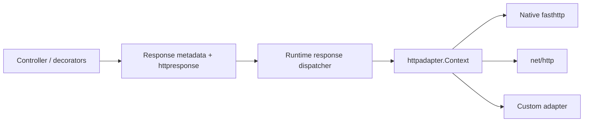

# Engine-independent HTTP responses

NestGo controllers can return ordinary values, return a typed `httpresponse.Response`, or
write explicitly through `@Res()`. These operations use a transport-neutral contract; your
controller does **not** import the fasthttp or net/http engine.

## Return values and helpers

```go
import "github.com/kevenmiano/nestgo/httpresponse"

@Controller("/users")
type UsersController struct{}

@Get("/{id}")
func (c *UsersController) FindOne(@Param("id") id string) httpresponse.Response {
    return httpresponse.OK(map[string]string{"id": id}).
        WithHeader("Cache-Control", "no-store")
}

@Post("/")
func (c *UsersController) Create(@Body() dto UserDTO) httpresponse.Response {
    return httpresponse.Created(dto)
}

@Delete("/{id}")
func (c *UsersController) Remove(@Param("id") id string) httpresponse.Response {
    return httpresponse.NoContent()
}
```

**Helpers:** `JSON(value)`, `Text(string)`, `OK(value)`, `Created(value)`,
`Accepted(value)`, `NoContent()`, `Redirect(url, optionalStatus)`,
`WithStatus(code)`, `WithHeader(name, value)` and `WithCookie(Cookie)`.
Responses are immutable-by-convention: fluent methods return a modified **copy**.
A typed response takes precedence over a route's default status.

Ordinary values remain JSON-serialized, including plain strings. Use
`httpresponse.Text("hello")` to send a `text/plain` body.
GET defaults to 200; POST defaults to 201. Status 204, 304 and informational
responses are sent without a body.

## Declarative response decorators

```go
@Get("/cache")
@HttpCode(202)
@Header("Cache-Control", "private, max-age=60")
func (c *UsersController) Cached() any { return map[string]bool{"ok": true} }

@Get("/old")
@Redirect("/new", 301)
func (c *UsersController) Moved() string { return "" }
```

`@Header(name, value)` accepts two **quoted string literals**, may repeat, and is
applied before the handler executes; a dynamic writer can override a header.
`@Redirect(url, code)` accepts a quoted URL and optional 3xx integer status
(default 302). A returned `httpresponse.Redirect(...)` can override a
static decorator redirect. Invalid decorator arguments fail compilation.

## Explicit response writing

```go
@Get("/download")
func (c *UsersController) Download(@Res() res *httpresponse.Writer) error {
    return res.Status(200).
        Header("Content-Disposition", "attachment; filename=hello.txt").
        Send("hello")
}

@Get("/preview")
func (c *UsersController) Preview(@Res({passthrough:true}) res *httpresponse.Writer) any {
    res.Status(202).Header("X-Preview", "yes")
    return map[string]bool{"ready": true}
}
```

`@Response()` aliases `@Res()`. An explicit `@Res()` handler owns the
response; NestGo **does not** automatically serialize its return value.
If the handler completes without writing, the runtime responds with a 500
instead of leaving the request hanging. Use `@Res({passthrough:true})` to
set headers/status/cookies and still use automatic serialization.
`httpresponse.Writer` supports `Status`, `Header`, `Cookie`, `JSON`,
`Send`, `End`, and `Redirect`; writing twice returns an error.

Cookies use `httpresponse.Cookie` with standard fields such as `Name`,
`Value`, `Path`, `MaxAge`, `HTTPOnly`, `Secure` and `SameSite`.
Multiple `Set-Cookie` values require adapter support for the optional
`httpresponse.HeaderAppender` contract, implemented by both bundled engines.

## Typed HTTP exceptions

```go
@Get("/{id}")
func (c *UsersController) FindOne(@Param("id") id string) (any, error) {
    if id == "" {
        return nil, httpresponse.BadRequest("id is required")
    }
    return map[string]string{"id": id}, nil
}
```

Built-in typed errors: `NewHTTPError`, `BadRequest`, `Unauthorized`,
`Forbidden`, `NotFound`, `Conflict`, `UnprocessableEntity` and
`InternalServerError`. They serialize as
`{"statusCode":404,"message":"..."}`. Unrecognized errors produce an
opaque 500 JSON response; internal details are not exposed to clients.

## Architecture



The same response dispatcher is used by adapter-based applications and the
legacy `runtime.New` path. The response layer knows no native HTTP engine.
Adapters implement status, headers, and byte writing, with optional
multi-value header support.

**Current limits:** streaming, native request/response access, SSE, and
WebSockets are separate platform capabilities; this feature does not
promise them for every engine. Request-body limits and panic/filter pipelines
remain separate concerns. Use integration tests for your custom adapter.

See [HTTP adapters](HTTP_ADAPTERS.md) and [NestJS controller reference](https://docs.nestjs.com/controllers).
