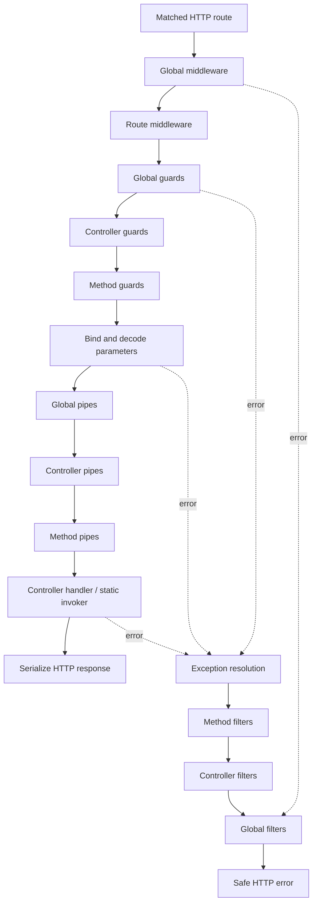

# HTTP request pipeline

> **Guides:** [Middleware](../website/docs/fundamentals/middleware.md) ·
> [Guards](../website/docs/fundamentals/guards.md) ·
> [Pipes](../website/docs/fundamentals/pipes.md) ·
> [Exception filters](../website/docs/fundamentals/exception-filters.md) ·
> [Executable example](../examples/pipeline/README.md)
>
> Inspired by the [NestJS request lifecycle](https://docs.nestjs.com/faq/request-lifecycle);
> this guide documents the actual NestGo contracts and their limitations.

NestGo compiles a NestJS-inspired HTTP request pipeline at startup. It is
independent of the HTTP engine (fasthttp by default; net/http is supported).
Pipelines use singleton providers for class-based components and reuse the
existing generated typed HTTP invocation path.

## Request lifecycle



As in NestJS, guards execute global → controller → method, while exception
filters resolve method → controller → global. The first filter that handles
an error stops propagation. Middleware errors are handled by **global
filters only**.

Middleware registered here is **route-level framework middleware**: the
HTTP adapter selects the route before invoking it. Unlike app-wide
Express middleware, it does not execute on 404/405 responses.

## Class-based guards, pipes and filters

The decorated sample below belongs in a **`.mgo` file**. Standard Go
source does not accept NestGo decorators; compile it first.

```go
package users

import (
    "strings"
    "github.com/kevenmiano/nestgo/httpadapter"
)

@Injectable()
type AuthGuard struct{}
func (*AuthGuard) CanActivate(ctx httpadapter.ExecutionContext) (bool, error) {
    return ctx.Request.Header("Authorization") != "", nil
}

@Injectable()
type TrimPipe struct{}
func (*TrimPipe) Transform(value any, meta httpadapter.ArgumentMetadata) (any, error) {
    if meta.Kind == "Param" {
        return strings.TrimSpace(value.(string)), nil
    }
    return value, nil
}

@Injectable()
type ErrorFilter struct{}
func (*ErrorFilter) Catch(err error, ctx httpadapter.ExecutionContext) (bool, error) {
    // Return false to delegate to another filter or the default responder.
    if httpadapter.StatusOf(err) != 400 { return false, nil }
    ctx.Request.Status(400)
    ctx.Request.SetHeader("Content-Type", "text/plain")
    return true, ctx.Request.Write([]byte("invalid request"))
}

@UseGuards(AuthGuard)
@Controller("/users")
type UsersController struct{}

@UsePipes(TrimPipe)
@UseFilters(ErrorFilter)
@Get("/{id}")
func (c *UsersController) FindOne(@Param("id") id string) string {
    return id
}

@Module({providers: [AuthGuard, TrimPipe, ErrorFilter], controllers: [UsersController]})
type UsersModule struct{}
```

`@UseGuards`, `@UsePipes` and `@UseFilters` work on controllers
and methods. Their arguments are local `@Injectable` classes. Comma
separated names and arrays are accepted: `@UseGuards(AuthGuard, RoleGuard)`
or `@UseGuards([AuthGuard, RoleGuard])`. The compiler validates names
and generates `reflect.Type` metadata plus static interface assertions.
Invalid guard/pipe/filter method signatures fail at Go compile time. The
runtime still checks module visibility and externally supplied metadata.

Generated registry source includes deduplicated checks such as:

```go
var _ httpadapter.Guard = (*AuthGuard)(nil)
var _ httpadapter.Pipe = (*TrimPipe)(nil)
var _ httpadapter.ExceptionFilter = (*ErrorFilter)(nil)
```

Class-based middleware uses `httpadapter.MiddlewareHandler` and `Use(Context, Next) error`,
with the same explicit Go interface assertion pattern:

```go
var _ httpadapter.MiddlewareHandler = (*AuditMiddleware)(nil)
// runtime.WithMiddlewareHandlers(&AuditMiddleware{})
```

Components are singletons, with ordinary NestGo field injection. They **must
be concurrency-safe**. For global components, use functional options:

```go
app, err := runtime.New(
    
    runtime.WithMiddleware(func(ctx httpadapter.Context, next httpadapter.Next) error {
        ctx.SetHeader("X-Framework", "NestGo")
        return next()
    }),
    runtime.WithRouteMiddleware("GET", "/users/{id}", auditMiddleware),
    runtime.WithGuards(globalGuard),
    runtime.WithPipes(globalPipe),
    runtime.WithFilters(globalFilter),
)
```

`WithRouteMiddleware` matches the exact method and **fully prefixed
route pattern**, not a URL prefix or glob. A middleware may terminate
the request by writing to the context and not calling `next`. Calling
`next` more than once is rejected. Middleware order is registration
order.

## Pipe and error contracts

Pipes run after decoding each decorated argument. `ArgumentMetadata`
contains `Index`, `Kind` (`Body`, `Param` or `Query`), `Name` and
the Go `Type`. Pipes may validate or transform values but must return
a value assignable to the handler's declared type. A type mismatch produces
HTTP 400. For validation failures, return
`httpadapter.NewHTTPException(400, "invalid input")`; a guard returning
`false` produces HTTP 403.

Unhandled errors produce HTTP 500 with a redacted message. Explicit
`HTTPException` values are returned with their declared 4xx code and safe
message. The default response is JSON (`statusCode` and `message`) through the typed
[HTTP response contract](HTTP_RESPONSES.md); filters may override formatting.

**Important differences from NestJS:** Pipes run on each argument in
handler-declaration order, not NestJS's reverse-parameter order. Custom
exception filters can delegate by returning `handled=false`. Code-first
handlers must explicitly call `httpadapter.BindParam`, `BindQuery` or
`DecodeBodyAt[T]` to trigger pipes.

**Current scope:** No parameter-specific `@UsePipes`, interceptors, request
scopes, wildcard/module middleware consumer, or middleware on unmatched
routes. These are deliberately separate features; no engine-specific
request objects are exposed by this pipeline.

Run `go test ./...`, `go test -race ./runtime ./httpadapter`, and the
HTTP benchmarks to verify behavior and overhead.

## Runnable example and verification

The [`examples/pipeline`](../examples/pipeline/README.md) directory
contains a complete guard, two pipes, an exception filter, middleware,
a code-first health route and an E2E test on both HTTP adapters.

```bash
go run ./cmd/modforge compile ./examples/pipeline
export DEMO_API_KEY=local-demo-key
go run ./examples/pipeline/cmd/server
go test ./examples/pipeline/... -v
```
