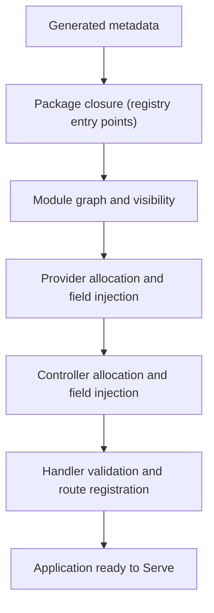

# Runtime and application lifecycle

NestGo supports two runtime entry points with different HTTP execution paths. For the authoritative illustrated walkthrough, see the [Docusaurus application lifecycle guide](../website/docs/fundamentals/lifecycle.md).

## Supported entry points

| Entry point | Return type | HTTP engine | Shutdown owner |
| --- | --- | --- | --- |
| `runtime.ApplicationFromRegistry(options, names...)` | `*runtime.Application` | fasthttp by default; adapter selectable | `app.Shutdown(ctx)` |
| `runtime.NewApplication(options, packages...)` | `*runtime.Application` | fasthttp by default; adapter selectable | `app.Shutdown(ctx)` |
| `runtime.FromRegistry(names...)` | `http.Handler` | standard net/http | caller |
| `runtime.New(packages...)` | `http.Handler` | standard net/http | caller |

All registry-based paths require generated metadata to be registered via Go package initialization. `ApplicationFromRegistry` / `FromRegistry` resolve transitive package imports before bootstrapping.

## Application bootstrap

Implementation detail: provider pointers are allocated before module validation in the adapter-based path; the diagram above summarizes logical responsibilities, not exact instruction order. The legacy `net/http` path has separate initialization and dispatch code. Provider fields support exported pointer/interface injection; `nestgo:"optional"` allows an unresolved field. Explicit modules enforce imports/exports visibility, while legacy modules without explicit scopes retain global DI. Constructor injection and provider lifecycle hooks are not supported.

## HTTP dispatch

Adapter applications register `httpadapter.Route` closures during boot. The default `fasthttp` adapter performs route matching; the optional `net/http` adapter uses `http.ServeMux`. The legacy `runtime.New` APIs construct their own `http.ServeMux`. All handler routes decode `Body`, `Param`, and `Query` metadata, invoke controller methods and serialize JSON results, with implementation-specific details and parity gaps.

Generated static invokers for eligible zero-argument routes are used by the legacy path only. The current adapter path invokes `reflect.Value.Call`.

## Shutdown

`Application.Shutdown(ctx)` delegates to the selected adapter, which shuts down the underlying HTTP server if started. There are no automatic signal handlers, provider cleanup hooks, or complete NestJS lifecycle phases. Integrations needing resource cleanup must coordinate it outside the framework.

## Runtime constraints

There is no complete built-in authentication/authorization, request-scoped injection, global validation/interceptor/filter pipeline, or automatic dependency resource disposal in these runtime paths. Errors during bootstrap are returned; adapter registrations performed before an error are not rolled back. Test and harden both HTTP paths before production exposure.

See also [HTTP adapters](HTTP_ADAPTERS.md), [architecture](ARCHITECTURE.md) and [lifecycle documentation](../website/docs/fundamentals/lifecycle.md).
