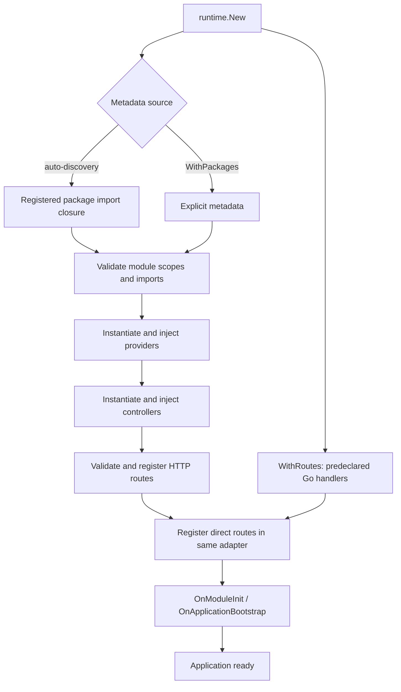

# Runtime and lifecycle

NestGo has **one application factory** and one lifecycle owner for all HTTP engines.

## Get started

### Plain Go HTTP server (no NestGo compiler)

```go
app, err := runtime.New(runtime.WithRoutes(runtime.Route{
    Method: "GET",
    Path: "/health",
    Handler: func(ctx runtime.Context) error {
        ctx.Status(200)
        return ctx.Write([]byte("OK"))
    },
}))
if err != nil { log.Fatal(err) }
log.Fatal(app.Listen(":8080"))
```

The `runtime` package is a regular Go dependency: no prebuilt runtime binary, NestGo code-generation step, or runtime compiler invocation is required. Go builds and links the imported package with the application, as it does for gRPC.

### Optional generated modules

```go
// The compiled package must be imported somewhere in the binary.
// import _ "example.com/yourapp/internal/app"
app, err := runtime.New()
if err != nil { log.Fatal(err) }
defer app.Shutdown(context.Background())
log.Fatal(app.Listen(":8080"))
```

`runtime.New(options ...runtime.Option)` returns `*runtime.Application`. Options:

| Option | Function |
| --- | --- |
| `WithRoutes(routes...)` | Register Go HTTP functions directly (no codegen) |
| `WithPackages(packages...)` | Provide metadata directly |
| `WithAdapter(adapter)` | Choose HTTP engine, default fasthttp |
| `WithLogger(logger)` | Enable structured bootstrap logging |
| `WithMiddleware(...)` | Register global matched-route middleware |
| `WithRouteMiddleware(method,path,...)` | Exact-route middleware |
| `WithGuards(...)` | Global guards |
| `WithPipes(...)` | Global argument pipes |
| `WithFilters(...)` | Global exception filters |
| `WithContext(ctx)` | Supply a cancellable bootstrap context |
| `WithDebug(true)` | Enable detailed per-provider diagnostics |
| `WithBootstrapMetrics(callback)` | Observe successful bootstrap durations |

`WithPackages` is reserved for explicit metadata fixtures and advanced embedding. Generated modules are loaded automatically when linked. A nil option is rejected. `Application` provides `Listen`, `Serve`, `Shutdown(ctx)`, `Close()` and `HTTPAdapter`; it does not expose a second `http.Handler` bootstrap.

## Lifecycle



Providers are initialized in stable type-name order and controllers follow metadata order. Field injection supports exported pointer and interface fields. The `nestgo:"optional"` tag permits missing optional dependencies; module scopes control imports and exports.

Direct Go handlers execute without reflective controller dispatch. For decorator-generated controllers, generated invokers can bypass reflective calls, while other handlers use reflection as needed. Both native `platform/fasthttp` and `platform/nethttp` use the same route namespace and lifecycle. Conflicts between direct and controller-generated routes are rejected at bootstrap.

`app.Shutdown(ctx)` runs `BeforeApplicationShutdown`, adapter shutdown, `OnModuleDestroy`, then `OnApplicationShutdown` in reverse instance order. It is idempotent and joins errors. Failed bootstrap attempts best-effort cleanup, but registered adapter routes are not transactionally rolled back. The caller owns OS signal handling and deadlines.

## Observability and constraints

Use `WithBootstrapMetrics` for route registration, lifecycle initialization and total durations. The `BenchmarkApplicationBootstrapProviders` benchmark and CI baseline comparison cover 1/10/100 providers.

Constructor injection, request scopes, automatic OS signals, universal filters/guards/interceptors and arbitrary resource disposal are not implemented. Successful application construction does not mean the HTTP port is bound.

See [HTTP adapters](HTTP_ADAPTERS.md) and [lifecycle guide](../website/docs/fundamentals/lifecycle.md).

See [the request pipeline](REQUEST_PIPELINE.md) for middleware, guard, pipe, and exception filter contracts.
