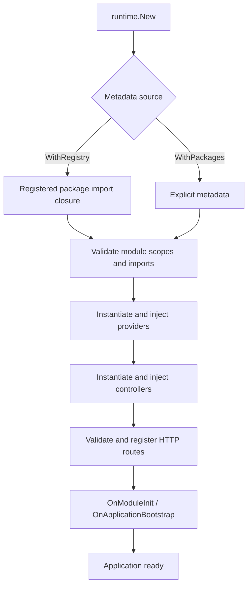

# Runtime and lifecycle

NestGo has **one application factory** and one lifecycle owner for all HTTP engines.

## Get started

```go
// Import the generated package to register its metadata.
app, err := runtime.New(runtime.WithRegistry("shop"))
if err != nil { log.Fatal(err) }
defer app.Shutdown(context.Background())
log.Fatal(app.Listen(":8080"))
```

`runtime.New(options ...runtime.Option)` returns `*runtime.Application`. Options:

| Option | Function |
| --- | --- |
| `WithRegistry(names...)` | Resolve registered packages and transitive module imports |
| `WithPackages(packages...)` | Provide metadata directly |
| `WithAdapter(adapter)` | Choose HTTP engine, default fasthttp |
| `WithLogger(logger)` | Enable structured bootstrap logging |
| `WithMiddleware(...)` | Register global middleware |\n| `WithRouteMiddleware(method, path, ...)` | Register middleware for an exact route |\n| `WithGuards(...)` | Register global guards |\n| `WithPipes(...)` | Register global parameter pipes |\n| `WithFilters(...)` | Register global exception filters |\n| `WithDebug(true)` | Enable detailed per-provider diagnostics |
| `WithBootstrapMetrics(callback)` | Observe successful bootstrap durations |

Do not combine `WithRegistry` and `WithPackages`. A nil option is rejected. `Application` provides `Listen`, `Serve`, `Shutdown` and `HTTPAdapter`; it does not expose a second `http.Handler` bootstrap.

## Lifecycle



Providers are initialized in stable type-name order and controllers follow metadata order. Field injection supports exported pointer and interface fields. The `nestgo:"optional"` tag permits missing optional dependencies; module scopes control imports and exports.

Generated invokers can bypass reflective calls, while other handlers use reflection as needed. Both native `platform/fasthttp` and `platform/nethttp` use the same route contract and lifecycle.

`app.Shutdown(ctx)` runs `BeforeApplicationShutdown`, adapter shutdown, `OnModuleDestroy`, then `OnApplicationShutdown` in reverse instance order. It is idempotent and joins errors. Failed bootstrap attempts best-effort cleanup, but registered adapter routes are not transactionally rolled back. The caller owns OS signal handling and deadlines.

## Observability and constraints

Use `WithBootstrapMetrics` for route registration, lifecycle initialization and total durations. The `BenchmarkApplicationBootstrapProviders` benchmark and CI baseline comparison cover 1/10/100 providers.

Constructor injection, request scopes, automatic OS signals, interceptors and arbitrary resource disposal are not implemented. See [request pipeline](REQUEST_PIPELINE.md) for middleware/guards/pipes/filters and limitations. Successful application construction does not mean the HTTP port is bound.

See [HTTP adapters](HTTP_ADAPTERS.md) and [lifecycle guide](../website/docs/fundamentals/lifecycle.md).
