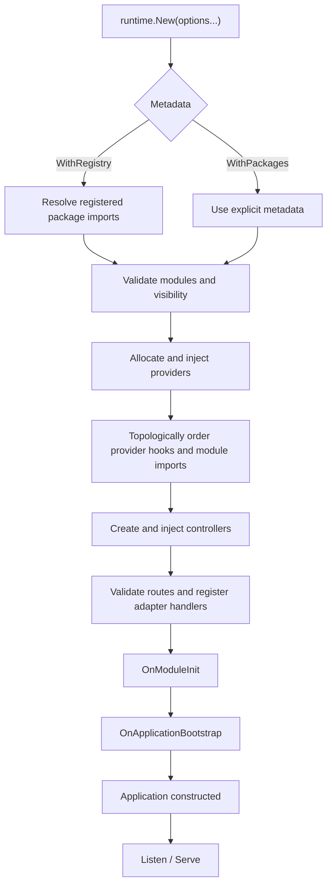
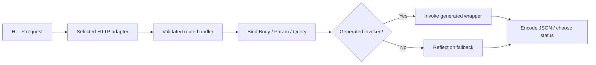
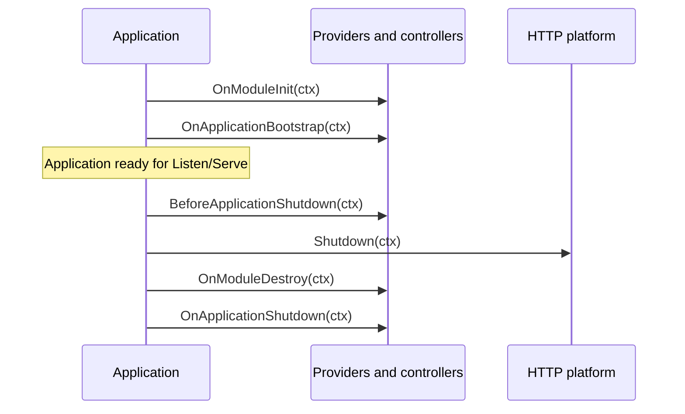

# Application lifecycle

NestGo has **one application** abstraction and an engine-independent lifecycle. The design is inspired by NestJS without promising identical functionality.

## Create an application

```go
app, err := runtime.New(runtime.WithRegistry("shop"))
if err != nil { log.Fatal(err) }

log.Fatal(app.Listen(":8080"))
```

The default engine is native fasthttp. To select the Go standard library, add `runtime.WithAdapter(nethttp.New())`. To pass metadata directly, use `runtime.WithPackages(packages...)`. Do not combine both metadata sources. Import generated Go packages so their `init()` registrations are linked.

The `*runtime.Application` provides `Listen`, `Serve`, `HTTPAdapter` and `Shutdown`. A bare HTTP handler is not a second framework lifecycle.

## Bootstrap



Module validation rejects missing imports, invalid exports, conflicting ownership and module import cycles. Provider injection supports exported pointer or interface fields, and `nestgo:"optional"` allows missing optional dependencies. Scope visibility honors `Imports`, `Providers` and `Exports`; no constructor injection is provided. Module import cycles and provider injection cycles fail bootstrap before any hook executes. Resolved injection edges (including interface and present optional dependencies) order provider hooks dependency-first. Independent members follow module import ordering; controllers run after providers.

## Request processing

Both fasthttp and net/http use `httpadapter.Route` handlers. Route signatures and parameter metadata are validated at bootstrap; generated static invocation can avoid `reflect.Call`, while unsupported signatures use the dynamic fallback.



POST defaults to HTTP 201, other successful routes to HTTP 200 unless status metadata overrides it. Actual platform routing, middleware compatibility and latency can differ by adapter.

## Lifecycle hooks and shutdown



Initialization executes providers in dependency-first topological order, with module imports taking precedence among independent providers; controllers initialize afterward in module-aware order. Shutdown hooks execute in reverse initialization order. `app.Shutdown(ctx)` is idempotent and aggregates errors. If initialization fails or the bootstrap context is canceled, the application runs best-effort cleanup with a bounded independent rollback context. Routes registered before failure are not transactionally rolled back, but an application that fails construction is never served.

The application never automatically installs OS signal handlers. The caller provides the shutdown context and deadline. A successfully constructed Application does not imply a listening TCP socket.

## Metrics and logging

`runtime.WithBootstrapMetrics(callback)` delivers `BootstrapMetrics` after a successful bootstrap. `runtime.WithLogger(logger)` enables structured bootstrap logs and `runtime.WithDebug(true)` adds detailed provider diagnostics. No logging is needed in the normal per-request hot path.

Use `go test ./runtime -run '^$' -bench BenchmarkApplicationBootstrapProviders -benchmem` for reproducible 1/10/100-provider bootstrap workloads.

## Constraints

Request-scoped providers, constructor injection, automatic signals, transactional route rollback, universal guards/interceptors/filters and arbitrary resource disposal are not implemented.

See [runtime reference](https://github.com/kevenmiano/nestgo/blob/main/docs/RUNTIME.md) and [HTTP adapters](https://github.com/kevenmiano/nestgo/blob/main/docs/HTTP_ADAPTERS.md).
