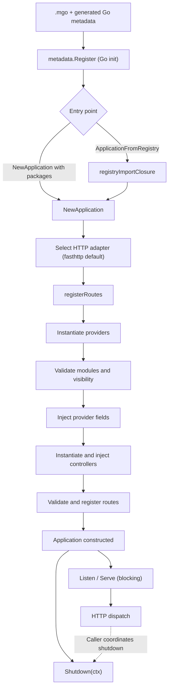
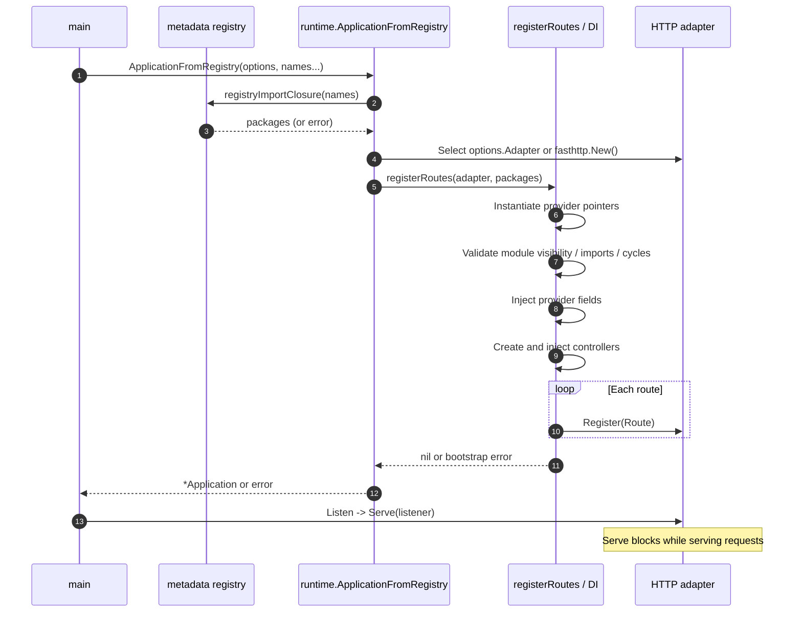
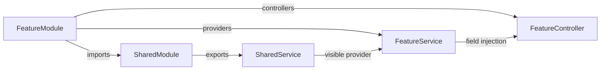
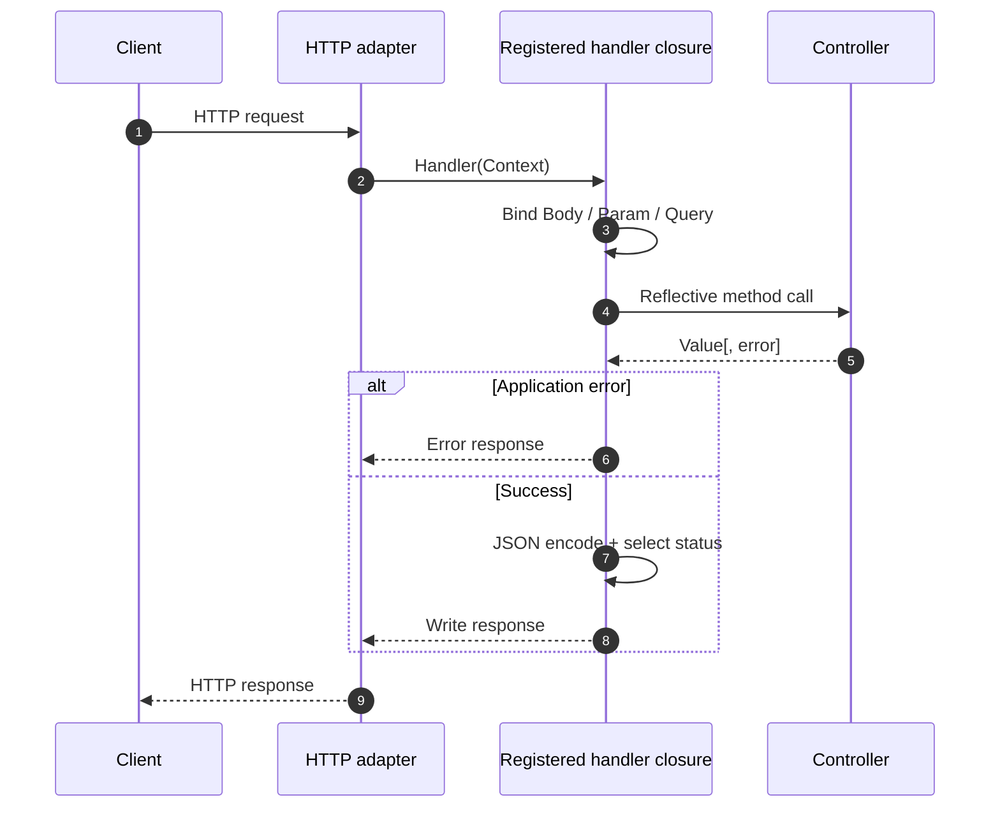
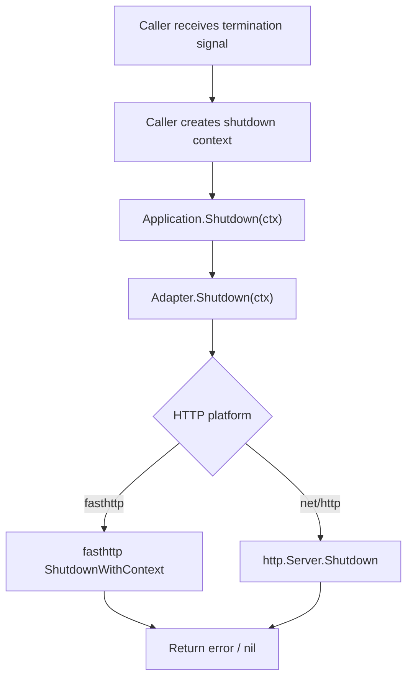
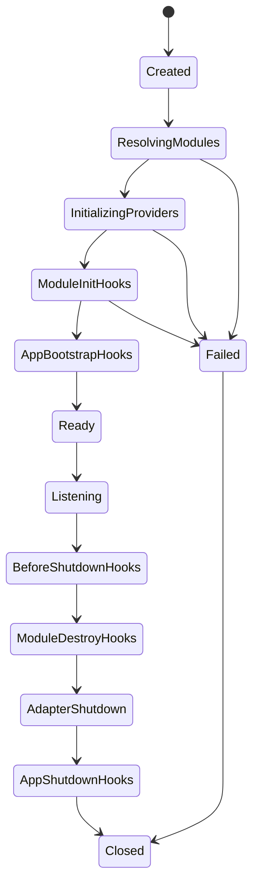

# Application lifecycle

NestGo takes inspiration from NestJS's module-oriented application model, but **its current lifecycle is not the NestJS lifecycle**. This page describes the implementation on `main`; the final section explicitly distinguishes planned capabilities.

## At a glance



The registry-based path resolves the **transitive registered package import closure** before constructing the application. Explicit `NewApplication` callers provide metadata packages themselves.

## Bootstrap sequence: adapter-based application

The adapter-based API is the recommended entry point when selecting an HTTP engine or controlling shutdown.

```go
app, err := runtime.ApplicationFromRegistry(runtime.ApplicationOptions{}, "shop")
if err != nil {
    log.Fatal(err)
}
log.Fatal(app.Listen(":8080"))
```

The generated shop package must be imported so its `init()` registration has executed. The registry name is the Go package name.



### Module boundaries and dependency injection

- Modules describe `Imports`, `Providers`, `Controllers` and `Exports` through generated metadata.
- Module validation rejects duplicate modules, unknown imports, invalid exports, missing registered providers, conflicting ownership and module import cycles.
- Each provider is instantiated as a pointer to a new struct. Exported pointer and interface fields are injected once at bootstrap, not per request.
- Pointer dependencies match exactly; interface dependencies require exactly one compatible visible provider. Missing required or ambiguous dependencies fail bootstrap. A field tagged `nestgo:"optional"` may remain unset.
- Explicit modules limit visibility to local providers and directly imported modules' exports. Legacy metadata without explicit module scopes retains global DI behavior.
- This is field injection, **not constructor injection**. An import-cycle check is **not** equivalent to detection of every provider dependency cycle; no general constructor/lifecycle ordering guarantee exists.



### Startup failure behavior

Construction returns an error when dependency/route validation or registration fails. The current `NewApplication` does not expose transactional rollback of already registered adapter routes or resource cleanup for arbitrary user-managed provider resources. Do not reuse an adapter after a failed bootstrap without checking its state.

## Two APIs, two dispatch implementations

| Aspect | `NewApplication` / `ApplicationFromRegistry` | `New` / `FromRegistry` |
| --- | --- | --- |
| Return value | `*runtime.Application` | `http.Handler` |
| HTTP platform | `fasthttp` default; customizable adapter | Go `net/http` ServeMux |
| DI | `registerRoutes` in `runtime/http_routes.go` | `NewWithOptions` in `runtime/runtime.go` |
| HTTP serving | `Application.Listen/Serve` | Caller runs `http.Server` |
| Shutdown | `Application.Shutdown(ctx)` delegates to adapter | Caller owns server shutdown |
| Static zero-arg invoker | Adapter path currently calls `reflect.Value.Call` | Legacy path uses `StaticInvoke` when eligible |
| Lifecycle logs | No equivalent structured bootstrap events in `NewApplication` | `NewWithOptions` emits bootstrap/DI/route events |

These implementations are **not guaranteed to have identical routing, performance, errors or instrumentation**. Check both paths before assuming feature parity.

## Request lifecycle (currently implemented)



In the adapter path, `@Body` uses JSON decoding with a 1 MiB check, `@Param` and `@Query` require string parameters, and results are JSON encoded. Defaults are HTTP 201 for POST and 200 otherwise. Route metadata can override the status. There is currently no documented, unified NestJS-style guard/pipe/interceptor/filter chain.

## Shutdown (currently implemented)

```go
ctx, cancel := context.WithTimeout(context.Background(), 10*time.Second)
defer cancel()
if err := app.Shutdown(ctx); err != nil {
    log.Printf("shutdown: %v", err)
}
```



NestGo does **not** automatically register OS signal handlers or invoke provider shutdown hooks. The application owner must orchestrate signal handling, deadline, and termination.

## Comparison with NestJS: implemented vs proposed

| Concept inspired by NestJS | NestGo status |
| --- | --- |
| Module imports / providers / controllers / exports | Implemented in generated module metadata and runtime visibility |
| Singleton-style bootstrap provider instances | Implemented for registered provider types |
| Injectable constructor factories, request/transient scopes | Not implemented in these runtime paths |
| `OnModuleInit` | Not implemented |
| `OnApplicationBootstrap` | Not implemented |
| `BeforeApplicationShutdown` | Not implemented |
| `OnModuleDestroy` | Not implemented |
| `OnApplicationShutdown` | Not implemented |
| Explicit application shutdown via adapter | Implemented |
| Automatic shutdown signals | Not implemented |
| Unified bootstrap across both HTTP APIs | Not implemented |

### Proposed lifecycle (design target, not current behavior)



Before implementing this target, specify dependency topological ordering, deterministic hooks, cancellation/deadlines, failures and rollback, idempotent shutdown, and parity between HTTP platforms. Do not attach hook names to user code until those contracts exist.

## Source of truth

- [`runtime/application.go`](https://github.com/kevenmiano/nestgo/blob/main/runtime/application.go): application factory, Serve/Listen/Shutdown.
- [`runtime/http_routes.go`](https://github.com/kevenmiano/nestgo/blob/main/runtime/http_routes.go): adapter-route DI and request dispatch.
- [`runtime/runtime.go`](https://github.com/kevenmiano/nestgo/blob/main/runtime/runtime.go): legacy net/http bootstrap and logs.
- [`runtime/module_visibility.go`](https://github.com/kevenmiano/nestgo/blob/main/runtime/module_visibility.go): graph validation and provider visibility.
- [`runtime/registry_imports.go`](https://github.com/kevenmiano/nestgo/blob/main/runtime/registry_imports.go): registered package closure.
- [`httpadapter/adapter.go`](https://github.com/kevenmiano/nestgo/blob/main/httpadapter/adapter.go): platform abstraction.
