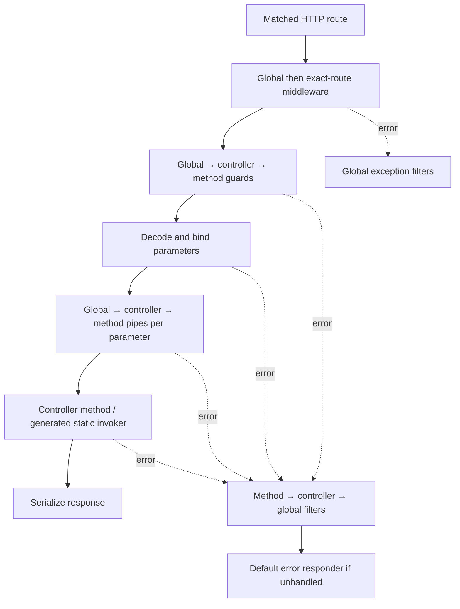

# HTTP request lifecycle

NestGo follows the ordering of [NestJS's request lifecycle](https://docs.nestjs.com/faq/request-lifecycle)
for **middleware, guards, pipes, handlers and exception filters** while
preserving an engine-neutral Go API. This page describes the pipeline as
implemented today, not every feature available in NestJS.



## Features

| Concept | Registration | Runs |
| --- | --- | --- |
| [Middleware](./middleware.md) | `runtime.WithMiddleware`, `WithRouteMiddleware` | After matching a route; before guards |
| [Guards](./guards.md) | `@UseGuards`, `runtime.WithGuards` | Global → controller → route |
| [Pipes](./pipes.md) | `@UsePipes`, `runtime.WithPipes` | On each decorated bound parameter |
| [Exception filters](./exception-filters.md) | `@UseFilters`, `runtime.WithFilters` | On error: route → controller → global |

Unlike NestJS interceptors, which wrap both sides of the request, **NestGo
does not currently implement interceptors**. No interceptor step is shown
because it would imply support that does not exist.

## Run the example

The working demo includes both a decorated `/users` controller and a
compiler-free `/health` route:

```bash
go run ./cmd/modforge compile ./examples/pipeline
export DEMO_API_KEY=local-demo-key
go run ./examples/pipeline/cmd/server
```

Then:

```bash
curl -i http://localhost:8080/health
curl -i -H 'X-API-Key: local-demo-key' http://localhost:8080/users/ada
curl -i -X POST http://localhost:8080/users/ \
  -H 'X-API-Key: local-demo-key' -H 'Content-Type: application/json' \
  -d '{"name":" Ada "}'
```

For all input cases and E2E tests, see the
[runnable example](https://github.com/kevenmiano/nestgo/tree/main/examples/pipeline).

## Go-specific behavior and differences

In NestGo, decorated classes are registered via `@Injectable()` and
`@Module({providers:[...], controllers:[...]})`, compiled to `reflect.Type`
metadata and resolved from singleton DI **at startup**. HTTP requests
use the selected FastHTTP or net/http adapter; guard/pipe/filter providers
must be concurrency-safe.

- Middleware applies to **matched routes only**, not unmatched 404/405;
  no NestJS `MiddlewareConsumer` or `app.use()` equivalent yet.
- Direct `runtime.WithRoutes` handlers get global middleware and guards,
  but must explicitly call `httpadapter.BindParam`, `BindQuery` or
  `DecodeBodyAt[T]` to trigger pipes.
- NestGo resolves pipes for parameters in declaration order, whereas
  NestJS processes route parameters in reverse order.
- An exception filter may return `handled=false` to delegate to the next
  scope. This differs from NestJS's exception matching mechanism.
- There are no request-scoped pipeline classes, parameter-level
  pipe decorators, interceptors or built-in NestJS validation transforms.

Errors that are not explicit 4xx `HTTPException` values become redacted
5xx responses. Method and controller exception filters do not catch
middleware failures; only global filters do.

Read [runtime details](https://github.com/kevenmiano/nestgo/blob/main/docs/REQUEST_PIPELINE.md).
