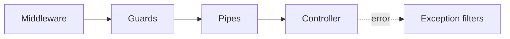

# Middleware, guards, pipes and exception filters

NestGo supports a transport-independent request pipeline inspired by NestJS:

Use `@UseGuards(AuthGuard)`, `@UsePipes(ValidationPipe)` and
`@UseFilters(ApiFilter)` on a controller or HTTP method. Classes must
implement the corresponding `httpadapter` interface and be registered
as `@Injectable` providers in the module.

Global components are registered through `runtime.WithMiddleware`,
`runtime.WithGuards`, `runtime.WithPipes` and `runtime.WithFilters`.
Exact routes can use `runtime.WithRouteMiddleware`.

For examples, ordering rules, validation and limitations, see the
[request pipeline reference](https://github.com/kevenmiano/nestgo/blob/main/docs/REQUEST_PIPELINE.md).
